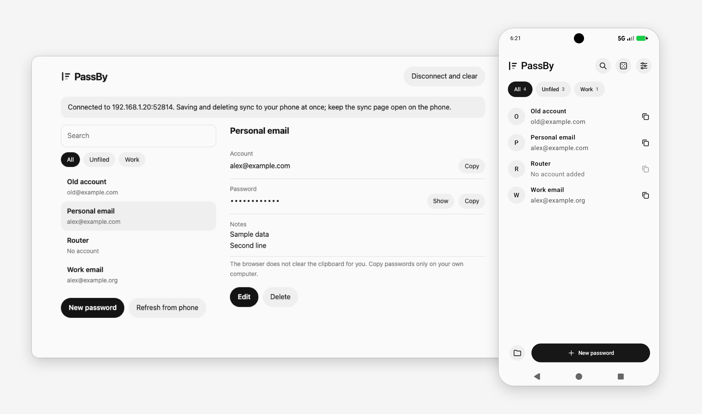
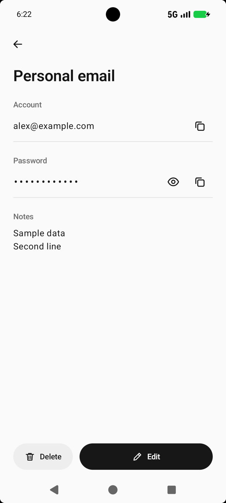
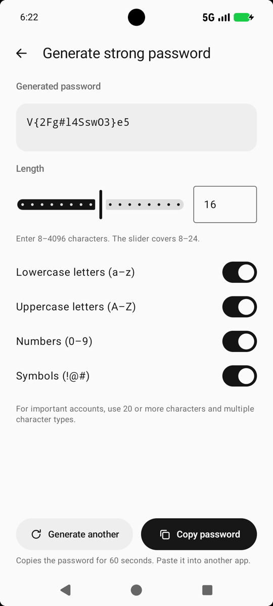
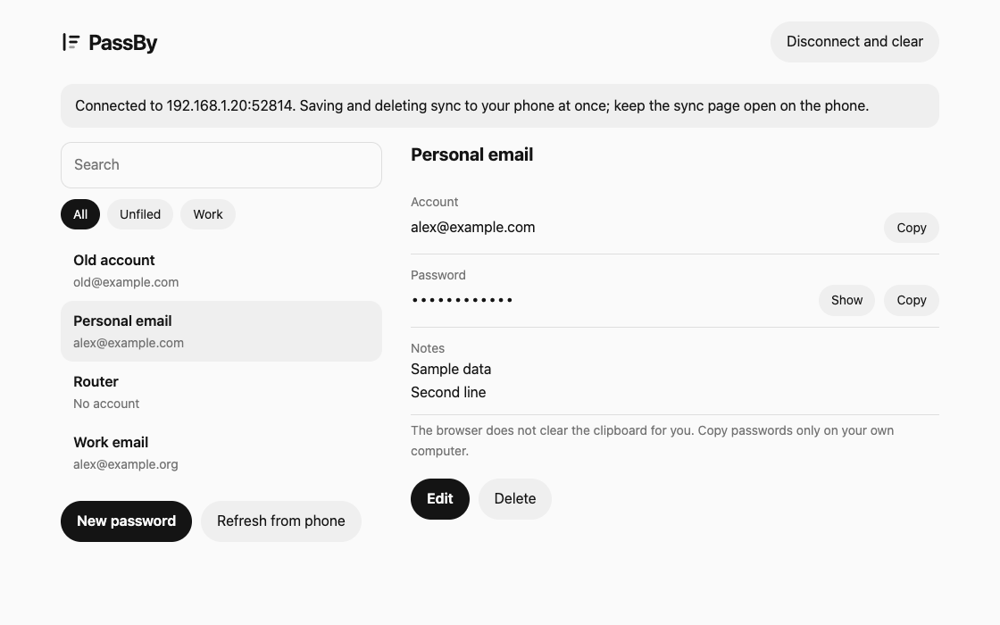
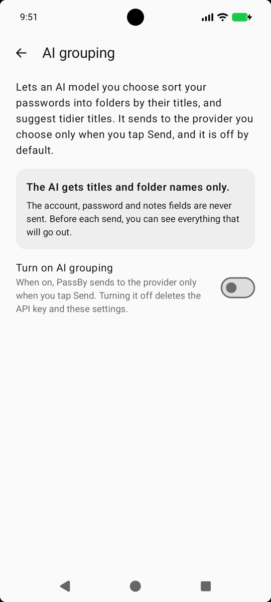

<p align="center">
  
</p>

<h1 align="center">PassBy</h1>

<p align="center">A simple password notebook.</p>

<p align="center">
  <a href="https://github.com/dozybot001/PassBy/releases"></a>
  <a href="LICENSE"></a>
</p>

<p align="center">
  <a href="https://passby.tenonai.cn/">Website</a> · <a href="https://github.com/dozybot001/PassBy/releases/latest">Download for Android</a> · <a href="#documentation">Docs</a> · <a href="README.zh-CN.md">简体中文</a>
</p>

<p align="center">
  <picture>
    <source media="(prefers-color-scheme: dark)" srcset="docs/assets/hero-dark-en.png">
    
  </picture>
</p>

No account, and nothing goes through our servers: your notebook is kept on your phone and moves with the phone's own backups. The app stays offline, with two exceptions: AI grouping, when you turn it on, connects to the model provider you choose; Sync connects to your other device on the same Wi-Fi. Free and open source under the MIT License.

## Quick start

| | Version | Where |
| --- | --- | --- |
| Android | 2.2.1 | `.apk` on [GitHub Releases](https://github.com/dozybot001/PassBy/releases) and [Gitee Releases](https://gitee.com/dozybot/PassBy/releases) |
| iPhone | 2.1 | In App Store review since 16 November 2026 |
| Web | — | <https://passby.tenonai.cn/app/>, Chrome or Edge on a computer, connected to a phone on the same Wi-Fi |

**Android** (8.0 or later)

1. Download `PassBy-<version>.apk` from [Releases](https://github.com/dozybot001/PassBy/releases).
2. Check it before installing: each release lists the installer's SHA-256. The installer is signed by Changsha Tenon Artificial Intelligence Technology Co., Ltd.; the signing certificate's SHA-256 fingerprint is in [`android/release/signing-certificate.sha256`](android/release/signing-certificate.sha256) and on the [Support page](https://passby.tenonai.cn/support/).
3. If an update ever reports a signature mismatch, do not install it.

**On a computer**: in PassBy on the phone, open Settings › Sync and tap “Let another device connect”. Open <https://passby.tenonai.cn/app/> on a computer on the same Wi-Fi and enter the address and pairing code the phone shows. Details and troubleshooting are on the [Support page](https://passby.tenonai.cn/support/).

**Build it yourself**

```sh
# iPhone (iOS 17 or later): run the tests
xcodebuild -project PassBy.xcodeproj -scheme PassBy \
  -destination 'platform=iOS Simulator,name=iPhone 18 Pro' \
  -derivedDataPath build CODE_SIGN_IDENTITY=- test

# Check the export and sync formats against the shared test vectors
node scripts/export-format.mjs --check
node scripts/sync-format.mjs --check
node scripts/sync-web-check.mjs
```

Android: see [docs/android.md](docs/android.md). The website in `public/` is static files with no build step.

## What it does

- **Just the notebook**: title, account, password and notes, in folders, with search; tap to copy, and the clipboard clears after 60 seconds.
- **Strong passwords on the spot**: a generator for 8 to 4096 characters, with letters, digits and symbols as you choose.
- **On your computer, over your own Wi-Fi**: pair the web version with your phone; traffic is encrypted, and the browser keeps nothing.
- **AI grouping, only if you ask**: off by default; suggests folders from titles only, and nothing changes until you confirm.

Also: a lock that asks for your fingerprint, face or screen lock when you open the app and after 5 minutes away; encrypted export and import of a `.passby` file, for your own backups or moving between iPhone and Android; English and Chinese; light and dark.

Not included: accounts, cloud sync through a server, autofill, ads, analytics.

## Screenshots

<p align="center">
  
  
  
  
</p>

## Where your data goes

Your notebook stays in the app's own folder on your phone and in the phone's own backups; there is no PassBy server. Only AI grouping, when you turn it on, sends entry titles and folder names to the provider you chose, and Sync sends the notebook, encrypted, to your other device on the same Wi-Fi. The full list is in [docs/privacy.md](docs/privacy.md) and the [Privacy Policy](https://passby.tenonai.cn/privacy/).

## Security

- The notebook is protected by the system's file encryption: on iPhone it can't be read while the phone is locked; on Android, not before the first unlock after a restart. PassBy adds no key of its own, so it is as safe as your screen lock. Without a screen lock this protection does not work, and the app tells you once.
- Export files use AES-256-GCM with a key derived from the export code or your passphrase by PBKDF2-HMAC-SHA256 (600,000 iterations). Neither is stored; lose it and the file can't be opened. Format: [docs/export-format.md](docs/export-format.md), with [test vectors](docs/export-vectors.json) shared by every platform.
- Only the platform's built-in cryptography is used, with no third-party crypto libraries.
- There has been no third-party security audit. Anyone with your unlocked phone, any app you paste a password into, and anyone with both an export file and its code can read your passwords.

To report a security problem, see [SECURITY.md](SECURITY.md); please don't open a public issue.

## Documentation

- [Design and decisions for 2.0](docs/local-notebook.md)
- [Export file format](docs/export-format.md) · [Sync over Wi-Fi](docs/sync.md)
- [Android](docs/android.md) · [App Store release notes](docs/app-store-release.md)
- [Privacy and data inventory](docs/privacy.md)
- [Changelog](CHANGELOG.md)
- Online: [Privacy Policy](https://passby.tenonai.cn/privacy/), [Terms](https://passby.tenonai.cn/terms/), [Support](https://passby.tenonai.cn/support/)

Most documents are in Chinese and record discussions and decisions as they were made; the code and the online pages above are authoritative. Notes for coding agents are in [AGENTS.md](AGENTS.md).

## Contributing

PassBy currently accepts these changes: security fixes, fixes for crashes or data loss, and corrections to text and translations. See [CONTRIBUTING.md](CONTRIBUTING.md) and the [Code of Conduct](CODE_OF_CONDUCT.md).

## License

[MIT](LICENSE). Copyright (c) 2026 Changsha Tenon Artificial Intelligence Technology Co., Ltd.

**Name and logos.** The PassBy and Tenon AI names and logos, including the icons in `PassBy/Assets.xcassets/`, `android/app/src/main/res/`, `public/web/`, `public/apple-touch-icon.png` and `docs/assets/logo.svg`, are not licensed under the MIT License. You may refer to them as they are to say that you use PassBy or that your work is based on it, but do not use them as the name or logo of your own product, or in a way that suggests your product comes from or is endorsed by Tenon AI. If you distribute your own build, change the name, the icons and the package identifiers (the iPhone bundle ID and the Android applicationId): they and the signature identify our release channels.

**Third-party notices.** The current code contains no third-party code or fonts. Earlier commits include the JetBrains Mono font (Copyright 2020 The JetBrains Mono Project Authors) under the SIL Open Font License 1.1; see [docs/third-party/JetBrainsMono-OFL.txt](docs/third-party/JetBrainsMono-OFL.txt). Open-source libraries in the Android app and their licenses are listed on the app's Open source licenses page.

---

<p>Publisher&emsp;&nbsp;<b>Tenon AI</b> · <a href="https://tenonai.cn/">tenonai.cn</a></p>
