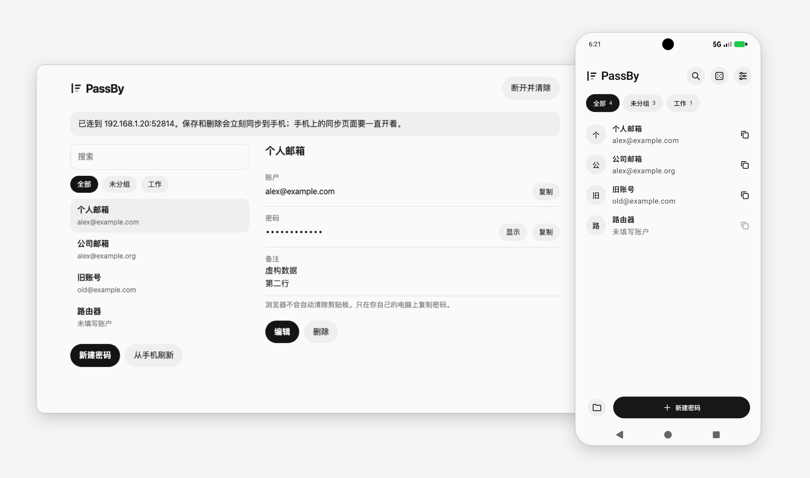
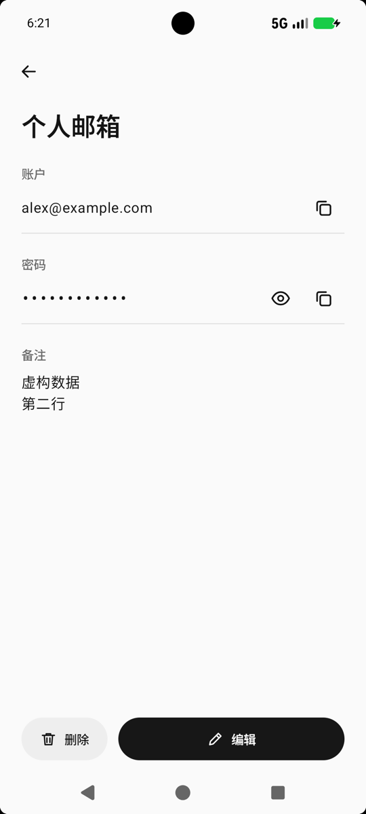
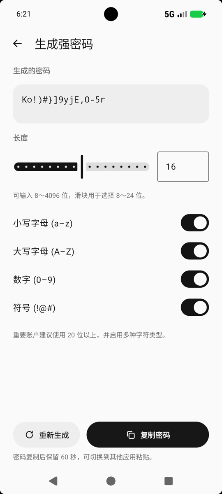
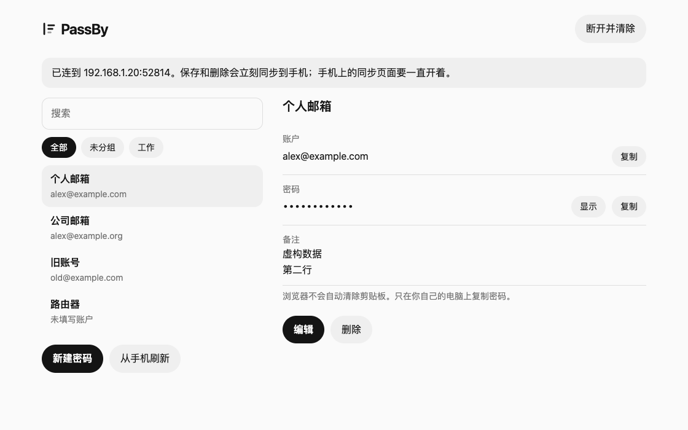
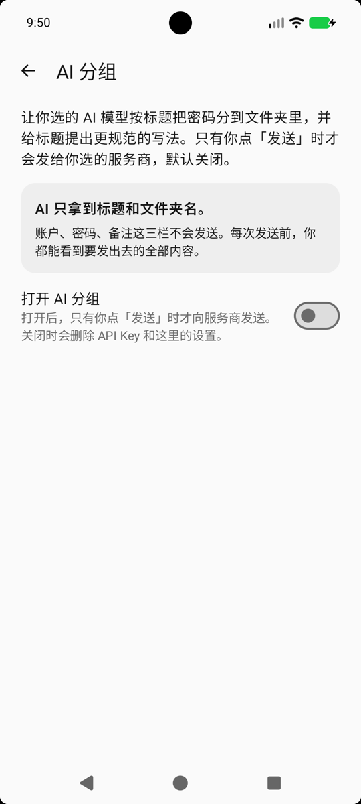

<p align="center">
  
</p>

<h1 align="center">PassBy</h1>

<p align="center">一个简单的密码本。</p>

<p align="center">
  <a href="https://github.com/dozybot001/PassBy/releases"></a>
  <a href="LICENSE"></a>
</p>

<p align="center">
  <a href="https://passby.tenonai.cn/">官网</a> · <a href="https://gitee.com/dozybot/PassBy/releases">下载安卓版</a> · <a href="#文档">文档</a> · <a href="README.md">English</a>
</p>

<p align="center">
  <picture>
    <source media="(prefers-color-scheme: dark)" srcset="docs/assets/hero-dark-zh.png">
    
  </picture>
</p>

没有账号，不经过我们的服务器；密码本由手机保管，跟着手机自己的备份和换机走。App 默认不联网，只在两种时候例外：你打开「AI 分组」时连你选的模型服务商，你用「同步」时在同一个 Wi-Fi 里连你的另一台设备。免费，源代码以 MIT 许可证公开。

## 快速开始

| | 版本 | 在哪里 |
| --- | --- | --- |
| 安卓 | 2.2.1 | 安装包（apk）在 [GitHub](https://github.com/dozybot001/PassBy/releases) 和 [Gitee](https://gitee.com/dozybot/PassBy/releases) 的 Releases 里 |
| iPhone | 2.1 | 已提交 App Store 审核（2026-11-16），通过后在 App Store 提供 |
| 网页 | — | <https://passby.tenonai.cn/app/>，电脑上的 Chrome、Edge，连同一个 Wi-Fi 里的手机使用 |

**安卓**（Android 8.0 或更高）

1. 在 [Releases](https://github.com/dozybot001/PassBy/releases) 里下载 `PassBy-<版本>.apk`。
2. 安装前可以核对：每个版本的说明里有安装包的 SHA-256；安装包由长沙榫卯人工智能科技有限公司签名（证书上是公司原来的英文名 Changsha Tenon Artificial Intelligence Technology Co., Ltd.），签名证书的 SHA-256 指纹登记在 [`android/release/signing-certificate.sha256`](android/release/signing-certificate.sha256)，也公布在[支持页](https://passby.tenonai.cn/support/)上。
3. 以后更新时，系统如果提示签名不一致，不要安装。

**在电脑上用**：在手机的 PassBy 里打开「设置 › 同步」，点「让别的设备连过来」；电脑连同一个 Wi-Fi，打开 <https://passby.tenonai.cn/app/>，输入手机上显示的地址和配对码。步骤和排查见[支持页](https://passby.tenonai.cn/support/)。

**自己构建**

```sh
# iPhone（iOS 17 及以上）：跑测试
xcodebuild -project PassBy.xcodeproj -scheme PassBy \
  -destination 'platform=iOS Simulator,name=iPhone 18 Pro' \
  -derivedDataPath build CODE_SIGN_IDENTITY=- test

# 导出格式和同步协议对照各端共用的测试向量
node scripts/export-format.mjs --check
node scripts/sync-format.mjs --check
node scripts/sync-web-check.mjs
```

安卓见 [docs/android.md](docs/android.md)。网站（`public/`）是静态文件，没有构建步骤。

## 能做什么

- **只是一本密码本**：标题、账户、密码、备注四栏，可以分文件夹、搜索；点一下复制，60 秒后清除剪贴板。
- **随手生成强密码**：8 到 4096 位，大小写字母、数字、符号自己选。
- **在电脑上用，只走你自己的 Wi-Fi**：网页版和手机配对后使用，传输加密，浏览器里不保存密码本。
- **AI 分组，你要才有**：默认关闭；只按标题建议分组，你确认后才改动。

另外还有：一道门（打开时和离开满 5 分钟后用指纹、人脸或锁屏密码验证，可以关）；加密导出和导入 `.passby` 文件，用来自己留备份、换手机，或者在 iPhone 和安卓之间搬；中文和英文，深色和浅色。

不做的：账号、经过服务器的云同步、自动填充、广告、统计。

## 截图

<p align="center">
  
  
  
  
</p>

## 数据去向

密码本只在手机上 App 自己的目录和手机自己的备份里，PassBy 没有服务器。只有你打开的「AI 分组」会把条目标题和文件夹名发给你选的服务商，「同步」会在同一个 Wi-Fi 里把密码本加密传给你的另一台设备。完整清单见 [docs/privacy.md](docs/privacy.md) 和[隐私政策](https://passby.tenonai.cn/privacy/)。

## 安全

- 密码本由系统的文件加密保护：iPhone 锁着时读不出来，安卓手机在开机后第一次解锁之前读不出来。PassBy 不另加自己的密钥，所以它的安全取决于手机的锁屏密码。没有设锁屏的手机，这层保护不起作用，App 会提示一次。
- 导出文件用 AES-256-GCM 加密，密钥由导出码或你设的口令经 PBKDF2-HMAC-SHA256（60 万次）派生。导出码和口令都不保存，丢了就打不开文件。格式见 [docs/export-format.md](docs/export-format.md)，各端共用同一份[测试向量](docs/export-vectors.json)。
- 加密只用系统自带的实现，不带第三方加密库。
- 没有请第三方做过安全审计。解锁了的手机、你粘贴进去的应用、拿到导出文件和导出码的人，都能读到密码。

发现安全问题请看 [SECURITY.md](SECURITY.md)，不要开公开的 issue。

## 文档

- [导出文件格式](docs/export-format.md) · [局域网同步](docs/sync.md)
- [安卓版](docs/android.md) · [AI 分组](docs/ai-grouping.md)
- [隐私与数据清单](docs/privacy.md)
- [更新记录](CHANGELOG.md)
- 线上：[隐私政策](https://passby.tenonai.cn/privacy/)、[用户协议](https://passby.tenonai.cn/terms/)、[支持](https://passby.tenonai.cn/support/)

文档描述 PassBy 现在的做法；和代码或线上页面有出入时，以代码和线上页面为准。给 agent 的项目说明在 [AGENTS.md](AGENTS.md)。

## 参与贡献

PassBy 目前只接受这几类改动：安全修复、崩溃或丢数据的修复、文字和翻译的更正。见 [CONTRIBUTING.md](CONTRIBUTING.md) 和[行为准则](CODE_OF_CONDUCT.md)。

## 许可证

[MIT](LICENSE)。Copyright (c) 2026 Tenon Artificial Intelligence Technology Co., Ltd. (长沙榫卯人工智能科技有限公司)

**名称和标志。** PassBy 和榫卯 Tenon 的名称和标志（包括 `PassBy/Assets.xcassets/`、`android/app/src/main/res/`、`public/web/`、`public/apple-touch-icon.png` 和 `docs/assets/logo.svg` 里的图标）不在 MIT 许可证的授权范围内。你可以照原样提到它们，说明你在使用 PassBy 或基于它修改；但不要把它们用作你自己产品的名称或标志，也不要让人以为你的产品来自榫卯 Tenon AI 或得到它的认可。自己构建或修改后分发的版本，请换掉名称、图标和包名（iPhone 的 Bundle ID、安卓的 applicationId）：包名和签名是我们发布渠道的标识。

**第三方声明。** 仓库现在的代码不包含第三方代码和字体。历史提交里带有 JetBrains Mono 字体（Copyright 2020 The JetBrains Mono Project Authors），按 SIL Open Font License 1.1 授权，许可原文见 [docs/third-party/JetBrainsMono-OFL.txt](docs/third-party/JetBrainsMono-OFL.txt)。安卓安装包里带的开源库和它们的许可证，见应用里的「开源许可」页。

---

<p>出品方&emsp;&nbsp;<b>榫卯 Tenon AI</b> · <a href="https://tenonai.cn/">tenonai.cn</a></p>
